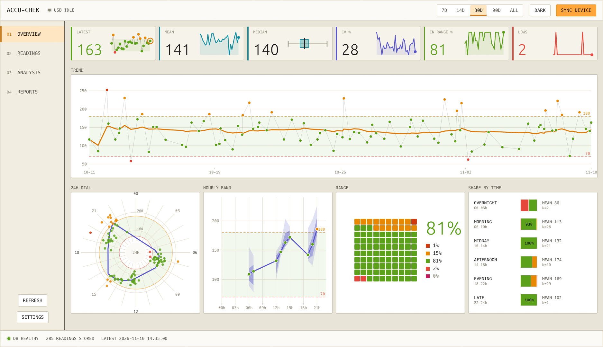
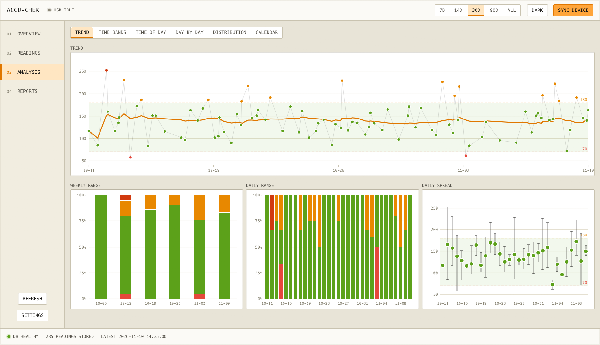
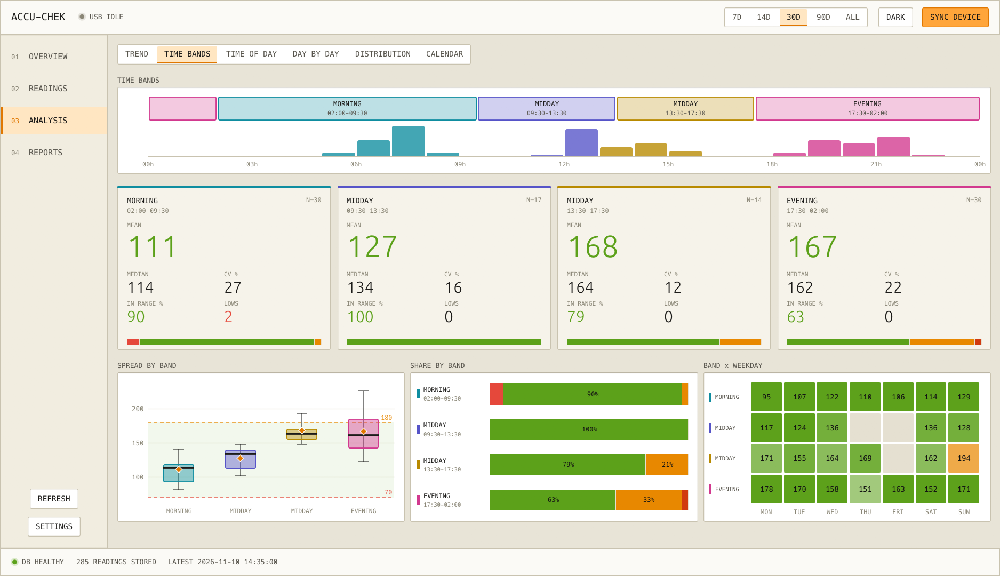
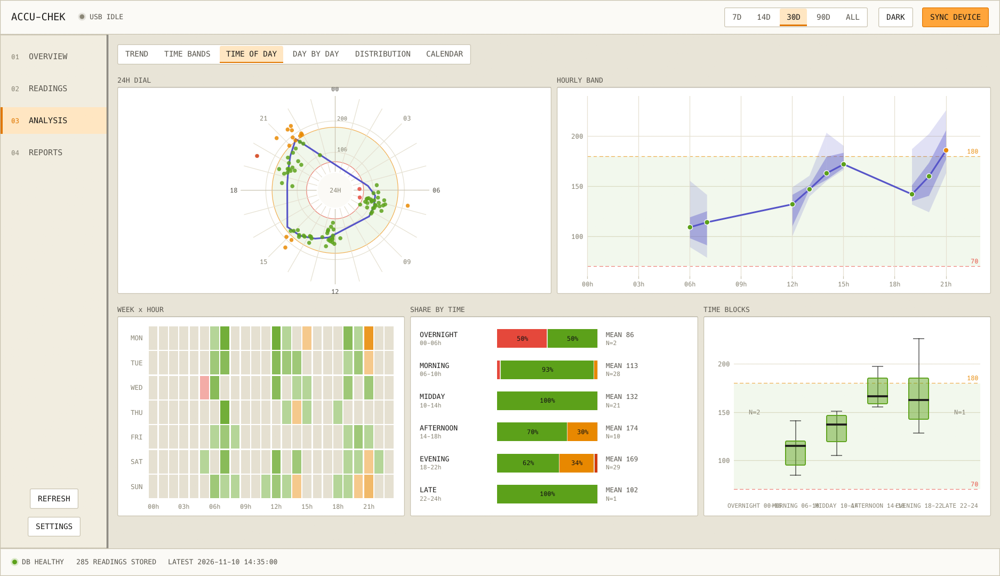
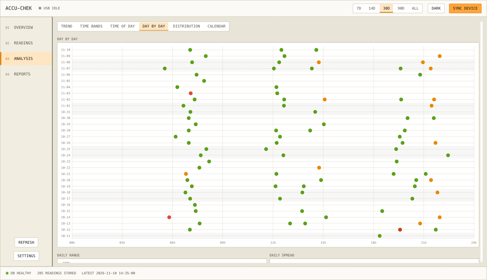
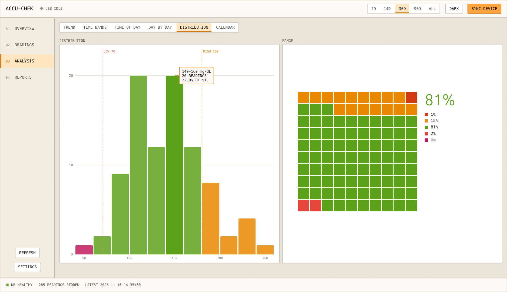
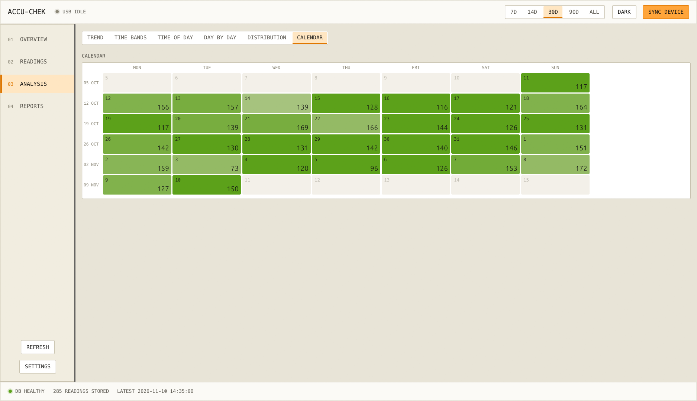
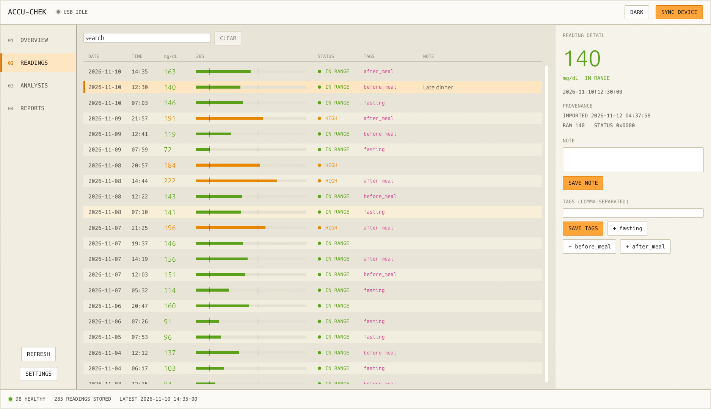
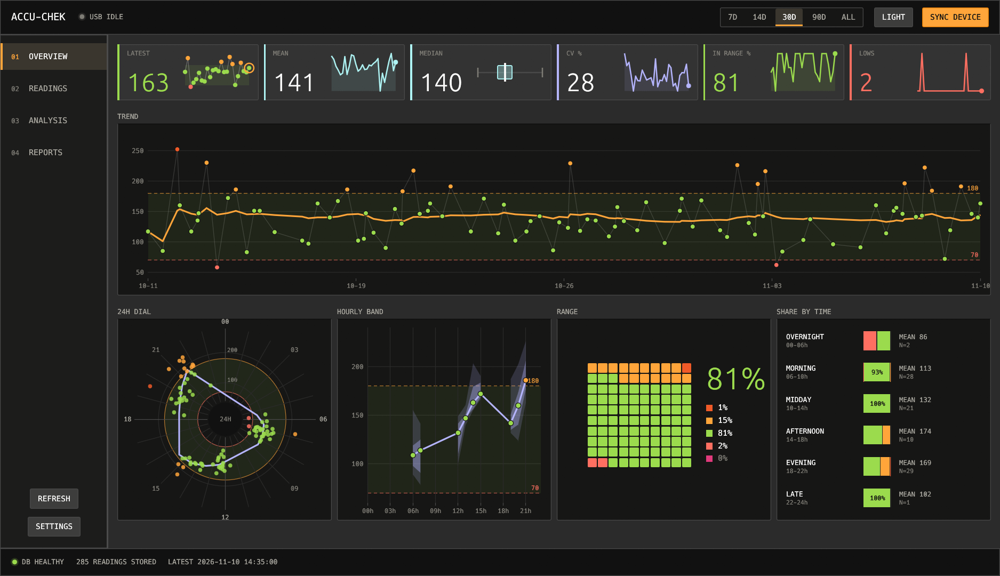

# Accu-Chek Local

A private, offline desktop app for Roche Accu-Chek blood glucose meters. It reads your meter over USB,
keeps every reading in a local SQLite database, and turns the numbers into charts you can read at a glance.
Nothing leaves your computer: no account, no cloud, no telemetry.

Written in Rust with [egui](https://github.com/emilk/egui). Runs on Windows and Linux.

> **Screenshots in this README use synthetic demo data** generated by `accuchek demo`. They are not real
> readings. See [Demo data and screenshots](#demo-data-and-screenshots).



## Contents

- [Features](#features)
- [A tour of the app](#a-tour-of-the-app)
- [Supported meters](#supported-meters)
- [Install and build](#install-and-build)
- [Connecting your meter](#connecting-your-meter)
- [Using the app](#using-the-app)
- [Command line](#command-line)
- [Where your data lives](#where-your-data-lives)
- [Demo data and screenshots](#demo-data-and-screenshots)
- [Project layout](#project-layout)
- [Development](#development)
- [Privacy and data safety](#privacy-and-data-safety)
- [Disclaimer](#disclaimer)
- [License](#license)

## Features

- **USB download** from supported Accu-Chek meters using the IEEE 11073 Personal Health Device protocol. The
  meter is only read, never written to.
- **Local-first storage** in SQLite. Raw meter values and status words are preserved, repeat syncs never create
  duplicates, and notes and tags are kept per reading.
- **Overview at a glance**: latest reading, mean, median, variability, in-range share and lows, each with a
  small trend graphic, above a full-width trend chart.
- **Time-of-day analysis** with a 24-hour dial, hourly percentile band, weekday-by-hour heatmap and
  per-part-of-day breakdowns.
- **Automatic time bands**: the app infers your own testing periods (for example Morning, Midday, Afternoon,
  Evening) from when you actually measure, then calculates the mean, median, variability, in-range share and
  lows for each band.
- **Day-by-day views**: a punch card with one dot per reading, daily range composition, daily spread and a
  calendar coloured by in-range share.
- **Readings table** with a built-in data bar, status, tags and notes, plus search and a detail panel for
  editing notes and tags.
- **Automatic fasting tags**: readings taken between 04:00 and 08:59 are tagged `fasting` on import and at
  startup (readings you already tagged are left alone).
- **mg/dL and mmol/L**, with configurable low and high thresholds.
- **PDF reports** of your statistics and charts.
- **Light and dark themes**, switchable from the top bar.

## A tour of the app

### Overview

Six compact KPI tiles with trend graphics, a full-width trend, the 24-hour dial, the hourly band, a 10x10
range grid (each square is 1% of readings) and the share of readings in range for each part of the day.


### Analysis

The Analysis page has six tabs. Use the period switch (7D, 14D, 30D, 90D, ALL) in the top bar to change the
window.

**Trend** shows every reading over time with a rolling 7-day mean, weekly and daily range composition and
daily spread.



**Time bands** infers parts of the day from your measuring habits and calculates the KPIs for each one: mean,
median, variability, in-range share and lows, with boxplots on a shared axis, range mix per band and a band by
weekday grid.



**Time of day** combines the 24-hour dial, hourly percentile band, weekday-by-hour heatmap and boxplots.



**Day by day** puts every reading on a punch card: one row per day, one dot per reading, positioned by time of
day and coloured by range.



**Distribution** shows a histogram with your thresholds marked and the range grid.



**Calendar** shades each day by how much of it was in range.



### Readings

A full-width table: date, time, value with a data bar and threshold ticks, status, tags and notes. Select a
row to edit its note and tags and to see where it came from (import time, raw value and status word).



### Dark theme



## Supported meters

The USB device allow-list lives in [`config.txt`](config.txt):

| Meter | USB ID |
|---|---|
| Accu-Chek Aviva Connect | `173a:21cf` |
| Accu-Chek Guide | `173a:21d5` |

Add other Roche PHDC/WinUSB meters by adding a line like `vendor_0x173a_device_0xXXXX 1`. IDs are
cross-checked against Tidepool's maintained Roche driver information. Protocol notes and invariants are in
[`docs/backend-research.md`](docs/backend-research.md).

## Install and build

You need a stable [Rust toolchain](https://rustup.rs/).

```bash
git clone https://github.com/bhadkamkar9snehil/accuchek-rust.git
cd accuchek-rust
cargo build --release
```

The binary is `target/release/accuchek` (`accuchek.exe` on Windows). SQLite is bundled, so no extra database
install is needed. On Linux you also need `libusb` (for example `sudo apt install libusb-1.0-0-dev`) and the
usual egui/winit system libraries.

## Connecting your meter

**Windows.** The meter needs the WinUSB driver.

1. Install [Zadig](https://zadig.akeo.ie/).
2. Plug in the meter, run Zadig as administrator, pick the Accu-Chek device and install **WinUSB**.
3. Start the app and press **SYNC DEVICE**.

**Linux.** Run the app with permission to access the USB device, either with a udev rule for vendor `173a` or
with `sudo`.

If sync fails, the status bar at the bottom of the window keeps the error until the next successful sync.
Run with `ACCUCHEK_DBG=1` for debug output.

## Using the app

| Page | What it is for |
|---|---|
| **Overview** | The current state: latest reading, KPIs, trend, dial, hourly band, range grid and share by part of day. |
| **Readings** | Browse, search and annotate every stored reading. |
| **Analysis** | Trend, Time bands, Time of day, Day by day, Distribution and Calendar. |
| **Reports** | Export a PDF report. |
| **Settings** | Glucose unit, low and high thresholds and data folder. |

Colours mean the same thing everywhere: very low (deep pink), low (coral), in range (green), high (orange) and
very high (red-orange). Hover over any chart mark to see the exact reading, time and value.

The wording is deliberately descriptive: the app talks about *sampled range* because a fingerstick meter takes
samples, not continuous readings.

## Command line

```text
accuchek                    Launch the app
accuchek sync [device_idx]  Download from the meter without the GUI; prints readings as JSON
accuchek path               Show data file locations
accuchek demo               Write synthetic demo data (needs ACCUCHEK_DATA_DIR)
accuchek help               Show help
```

Environment variables:

| Variable | Effect |
|---|---|
| `ACCUCHEK_DBG=1` | Enable debug output. |
| `ACCUCHEK_DATA_DIR=<dir>` | Use `<dir>` instead of the OS data directory (database, settings and config). |

## Where your data lives

Run `accuchek path` to see the exact locations.

| OS | Data directory |
|---|---|
| Windows | `%APPDATA%\accuchek` |
| Linux | `~/.local/share/accuchek` |
| macOS | `~/Library/Application Support/accuchek` |

| File | Contents |
|---|---|
| `accuchek.db` | SQLite database: readings (mg/dL and mmol/L), raw values, status words, notes, tags, devices |
| `settings.json` | Unit, thresholds and theme |
| `config.txt` | Device allow-list and optional custom database path |

Back up by copying the data directory. To start fresh, delete `accuchek.db`.

## Demo data and screenshots

To try the app without a meter, or to take screenshots without exposing real readings, point it at a throwaway
directory and generate synthetic data:

```bash
# PowerShell
$env:ACCUCHEK_DATA_DIR = "$env:TEMP\accuchek-demo"
.\target\release\accuchek.exe demo   # writes about 90 days of synthetic readings
.\target\release\accuchek.exe        # opens the app on the demo database
```

```bash
# bash
export ACCUCHEK_DATA_DIR=/tmp/accuchek-demo
./target/release/accuchek demo
./target/release/accuchek
```

`accuchek demo` refuses to run unless `ACCUCHEK_DATA_DIR` is set, so it can never write into your real database.

The images in `docs/images/` are produced from that synthetic data. To regenerate them, set both
`ACCUCHEK_DATA_DIR` (the demo directory) and `ACCUCHEK_SCREENSHOT_DIR` (the output folder) and start the app;
it visits each page, saves a PNG and exits. Screenshot mode does nothing unless both variables are set.

## Project layout

```text
src/
  main.rs            entry point and CLI
  gui.rs             application shell, pages and layout
  gui_theme.rs       light and dark design tokens and small widgets
  gui_charts.rs      custom-painted charts, KPI tiles and time-band inference
  stats.rs           descriptive statistics
  units.rs           mg/dL and mmol/L handling and thresholds
  storage.rs         SQLite storage (schema, migrations, operations)
  device.rs          USB discovery and the meter download session
  protocol.rs        IEEE 11073 PHDC protocol constants and framing
  export.rs          PDF report generation
  demo.rs            synthetic demo data
docs/
  backend-research.md      protocol lineage and storage invariants
  superpowers/specs/       design and visual-system specifications
  images/                  README screenshots (synthetic data)
```

## Development

```bash
cargo test                 # unit tests (storage, protocol, parsing, tagging)
cargo build --release
```

Continuous integration builds a Windows release binary and runs the backend tests on every push (see
`.github/workflows`).

The visual direction is documented in
[`docs/superpowers/specs/2026-09-13-accuchek-tactile-swiss-design-system.md`](docs/superpowers/specs/2026-09-13-accuchek-tactile-swiss-design-system.md).

## Privacy and data safety

- All data stays on your computer. The app makes no network requests.
- The meter is read-only; the app never changes meter settings or data.
- Real readings, databases, exports and settings files should never be committed. `.gitignore` excludes
  `*.db`, `settings.json`, PDFs and spreadsheets.
- Use the [demo data](#demo-data-and-screenshots) for screenshots, bug reports and examples.

## Disclaimer

This is an independent, community project. It is not affiliated with or endorsed by Roche or Accu-Chek.
It is a data viewer, not a medical device: summaries describe stored readings only and are not medical advice.
Talk to your healthcare provider before making any treatment decision.

## License

MIT. See [LICENSE](LICENSE).
